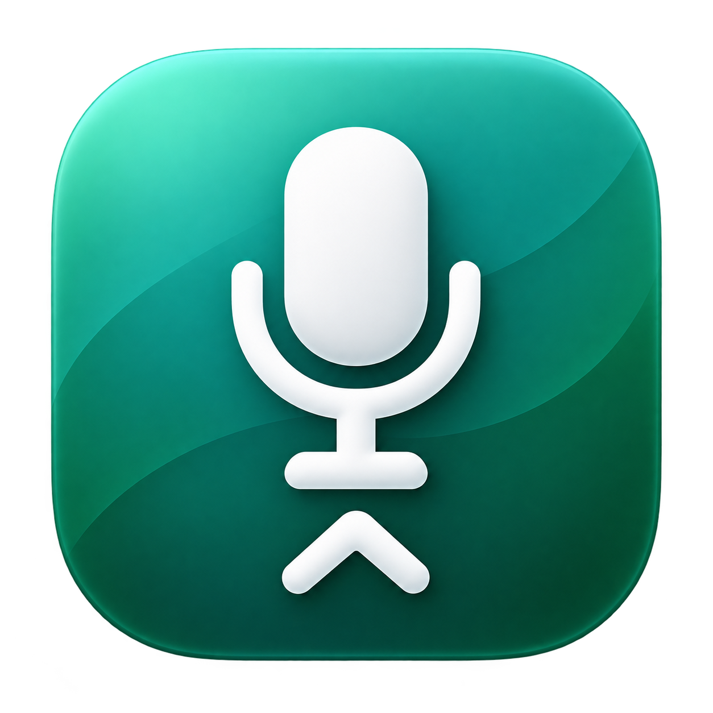

<p align="center">
  
</p>

# Mic Priority

Mic Priority is a small native menu-bar app that keeps the microphone you prefer as the system default. When AirPods, headphones, displays, docks, or other audio devices connect and macOS changes the input, Mic Priority restores the highest-ranked microphone that is currently available.

## Features

- Ordered microphone priority list: the highest connected device wins
- Automatic recovery when macOS changes the default input
- Falls back when a preferred microphone disconnects and restores it when it returns
- One-click pause, manual selection, and access to Sound Settings
- Optional Launch at Login using Apple's `SMAppService`
- Native Swift/AppKit/SwiftUI app with no external dependencies
- No recording, analytics, network access, or microphone permission required

## Requirements

- macOS 13 Ventura or later
- Apple Silicon or Intel Mac

## Install

1. Download the latest `Mic-Priority` ZIP from Releases.
2. Unzip it and move **Mic Priority.app** into `/Applications`.
3. Open it. A microphone icon appears in the menu bar.
4. Add microphones and arrange them from highest to lowest priority.

The initial community build is ad-hoc signed because this project does not yet have an Apple Developer ID certificate. macOS may require you to Control-click the app, choose **Open**, then confirm once. See [Distribution](#distribution) for signing details.

## How it works

Mic Priority uses the public Core Audio Hardware API. It listens for changes to the connected audio-device list and the system default input device. After a short debounce, it chooses the first connected device in your saved priority order and sets that device as the default input. Selection is verified and retried up to three times.

Powering off, unplugging, or otherwise disconnecting a microphone makes it unavailable, so the app automatically selects the next connected device in the priority list. A hardware mute button that leaves the microphone connected does not trigger a switch because Core Audio still reports that device as available.

On first launch, the current macOS input is automatically added as the initial preferred microphone, so installing the app does not unexpectedly select another device.

Preferences are stored locally in macOS UserDefaults under the bundle identifier `dev.rallen.macos-mic-priority`.

## Build

Only the Xcode Command Line Tools and macOS SDK are required:

```sh
./scripts/check.sh
./scripts/build.sh
```

The release build is universal (`arm64` and `x86_64`) by default. Set `UNIVERSAL_BUILD=0` for a faster local build targeting only the current Mac.

The application bundle is written to `build/Mic Priority.app`. To install the local build:

```sh
./scripts/install.sh
```

Create release artifacts with:

```sh
./scripts/package-release.sh
```

With the app installed and at least two microphones connected, run the end-to-end Core Audio restoration test with `./scripts/integration-test.sh`. It temporarily selects another input and verifies that the app restores the preferred one.

## Uninstall

Turn off **Launch at Login**, quit the app, then move it from `/Applications` to the Trash. Source builds can perform those steps with `./scripts/uninstall.sh`. Preferences are retained so reinstalling restores the priority list.

## Distribution

Local builds are ad-hoc signed. For a trusted public distribution, install a valid **Developer ID Application** certificate and build with:

```sh
SIGN_IDENTITY="Developer ID Application: Your Name (TEAMID)" ./scripts/package-release.sh
```

Submit the resulting archive with Apple's `notarytool`, staple the accepted ticket to the app, and recreate the archive before publishing. Signing credentials and notarization profiles must never be committed.

## Privacy and security

Mic Priority does not capture microphone audio. It reads device names, stable Core Audio identifiers, connection status, and the current default input. It has no network functionality. See [PRIVACY.md](PRIVACY.md) and [SECURITY.md](SECURITY.md).

## Project provenance

This is an independent implementation built from scratch with public Apple APIs. It contains no source code, binaries, or artwork from similarly purposed applications. The app icon is original artwork generated specifically for this project.

## Contributing

Bug reports and focused pull requests are welcome. Read [CONTRIBUTING.md](CONTRIBUTING.md) before contributing.

## License

MIT © 2026 Ryan Allen. See [LICENSE](LICENSE).
